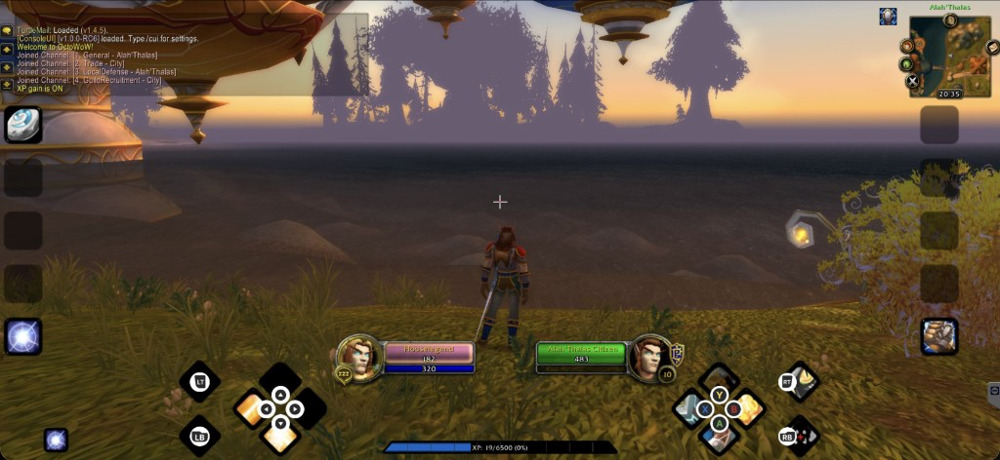
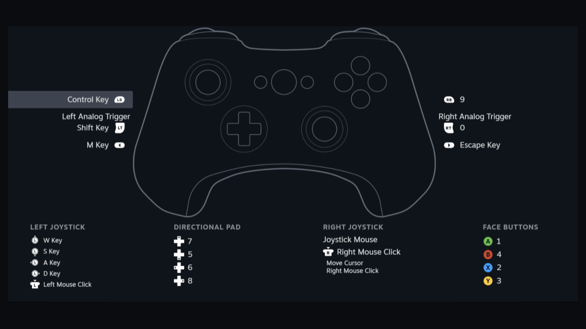
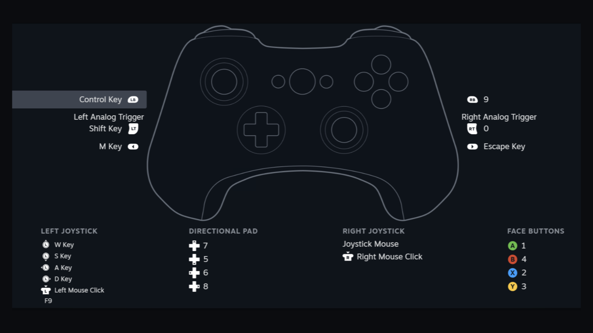

  

<strong>Play Vanilla with a controller.</strong>

  Original Vanilla · 1.12

  <a href="https://github.com/racha/ConsoleUI/releases/latest">Download latest</a> ·
  <a href="https://racha.github.io/ConsoleUI/">Guide</a> ·
  <a href="https://github.com/racha/ConsoleUI/issues">Issues</a>

  
  

Action bars, Mouse Look, Quick Menu, Rings, a virtual cursor, touch bars, and a radial keyboard. Built for the original 1.12 client.

OctoWoW, TurtleWoW, RavenCraft, Capybara Paradise. Not Retail, not modern Classic.

  

## Start here

1. [Install both folders](https://racha.github.io/ConsoleUI/getting-started/install/)
2. [Pick a camera](https://racha.github.io/ConsoleUI/getting-started/controller-setup/)
3. [First launch](https://racha.github.io/ConsoleUI/getting-started/first-launch/)

## Install

1. [Download latest](https://github.com/racha/ConsoleUI/releases/latest) from GitHub Releases.
2. Quit WoW completely.
3. Copy both `ConsoleUI` and `ConsoleUIKeyboard` into `Interface/AddOns/`.
4. Enable both addons at character selection.
5. Log in and type `/cui`.

The final paths must be `Interface/AddOns/ConsoleUI/` and `Interface/AddOns/ConsoleUIKeyboard/`. Do not put the ZIP’s outer folder inside `AddOns`.

The file you add to Steam is the one you actually start: `WoW.exe`, `Wow.exe`, or `VanillaTweaks.exe`. Full steps are on [Install](https://racha.github.io/ConsoleUI/getting-started/install/).

## Two cameras. Same addon.

Both styles use the same addons. Pick the mapper layout that matches how you want to look around.

<table>
  <tr>
    <td width="50%" align="center"><strong>Standard</strong></td>
    <td width="50%" align="center"><strong>MouseLOCK</strong></td>
  </tr>
  <tr>
    <td></td>
    <td></td>
  </tr>
  <tr>
    <td>Right-stick move parks the cursor top-left and holds right-click. Mouse Look stays off. Center the stick to use the cursor.</td>
    <td>WASD also starts Mouse Look. R3 unlocks. Unlock before using touch.</td>
  </tr>
</table>

Vanilla has no gamepad API. Steam Input or another mapper turns the pad into keys. F9 is only the MouseLOCK WASD companion. Do not add mapper commands for jump, casts, or UI actions.

Use the [Steam Standard](https://racha.github.io/ConsoleUI/controller/steam-standard/) or [Steam MouseLOCK](https://racha.github.io/ConsoleUI/controller/steam-mouselock/) guide. Other tools: [Other mappers](https://racha.github.io/ConsoleUI/controller/other-mappers/).

## In the guide

- **[Action bars](https://racha.github.io/ConsoleUI/features/action-bars/)** — Controller, Flat, and Full. Modifier pages, stance, pet.
- **[Mouse Look](https://racha.github.io/ConsoleUI/features/mouse-look/)** — Lock the camera. Unlock with right-click.
- **[Quick Menu](https://racha.github.io/ConsoleUI/features/quick-menu/)** — Bags, map, spellbook, quests, social, chat, settings.
- **[Rings](https://racha.github.io/ConsoleUI/features/rings/)** — Your eight-slice spell and item wheels.
- **[Cursor and touch](https://racha.github.io/ConsoleUI/features/touch-cursor/)** — Stick through Blizzard panels. Optional phone and Deck bars.
- **[Keyboard](https://racha.github.io/ConsoleUI/features/keyboard/)** — Radial chat. Y space, X erase, A send, B close.

Also: [Bindings](https://racha.github.io/ConsoleUI/features/bindings/), [HUD and Frames](https://racha.github.io/ConsoleUI/features/hud-frames/), [Profiles](https://racha.github.io/ConsoleUI/features/profiles/), [Settings](https://racha.github.io/ConsoleUI/reference/settings/), [Commands](https://racha.github.io/ConsoleUI/reference/commands/).

## Mapping

The shared table lives in [Mapping reference](https://racha.github.io/ConsoleUI/controller/mapping-reference/).

| Controller | Output | Role |
| --- | --- | --- |
| A / X / Y / B | `1` / `2` / `3` / `4` | Face action slots |
| D-pad Down / Left / Up / Right | `5` / `6` / `7` / `8` | D-pad action slots |
| RB / RT | `9` / `0` | Extra action slots |
| LT / LB | Shift / Ctrl | Modifier pages |
| Left stick | W/A/S/D | Movement |
| Right stick | Mouse | Camera or cursor |
| Start / Back | Escape / M | Game menu / map |

Hold LT, LB, or both for the four action pages. A/D may stay Turn or be rebound to Strafe; Quick Menu and Rings support both. Strafe usually feels better on a pad.

## Repository

| Path | Role |
| --- | --- |
| [`ConsoleUI/`](ConsoleUI/) | Action bars, stance/pet, Mouse Look, Quick Menu, Rings, cursor, touch bars, HUD, loot, bindings, settings, frames, and profiles. |
| [`ConsoleUIKeyboard/`](ConsoleUIKeyboard/) | Optional radial keyboard for chat and text fields. Requires `ConsoleUI`. |
| [`docs/`](docs/) | Guide source. |
| [`web/`](web/) | GitHub Pages site. |
| [Releases](https://github.com/racha/ConsoleUI/releases/latest) | Download latest ZIP. |
| [Issues](https://github.com/racha/ConsoleUI/issues) | Bugs and questions. |

## Interact

[Interact](https://github.com/vargv666/Interact) is a separate client mod for loot, herbs, veins, and NPCs. It is not in the ZIP.

## Support

Version notes: [Changelog](https://racha.github.io/ConsoleUI/reference/changelog/). If something fails, start with [Troubleshooting](https://racha.github.io/ConsoleUI/reference/troubleshooting/) or [FAQ](https://racha.github.io/ConsoleUI/reference/faq/). Include the client, mapper/layout, exact steps, first error, a screenshot, and `/cui test` output. Remove private names, paths, and chat before posting logs.

Supported clients: [Compatibility](https://racha.github.io/ConsoleUI/reference/compatibility/).

## For developers

Extend it from the [developer overview](https://racha.github.io/ConsoleUI/development/overview/), [public API](https://racha.github.io/ConsoleUI/development/api/), and [cursor integrations](https://racha.github.io/ConsoleUI/development/cursor-integrations/). See [CONTRIBUTING.md](CONTRIBUTING.md).

## Credits

Made by **HouseLegend**. Same names as `/cui` → About on [Credits](https://racha.github.io/ConsoleUI/reference/credits/).

World of Warcraft is a trademark of Blizzard Entertainment. This project is for educational purposes only. It is not affiliated with Blizzard or any private server.

- [World of Warcraft](https://www.blizzard.com) — Blizzard Entertainment
- [ConsoleExperience Classic](https://github.com/pepordev/ConsoleExperienceClassic) — Pedro · pepordev
- [ConsolePortLK](https://github.com/leoaviana/ConsolePortLK) — leoaviana
- [ConsolePort](https://github.com/seblindfors/ConsolePort) — Sebastian Lindfors · MunkDev
- [Cursor](https://cursor.com) — development assistance
